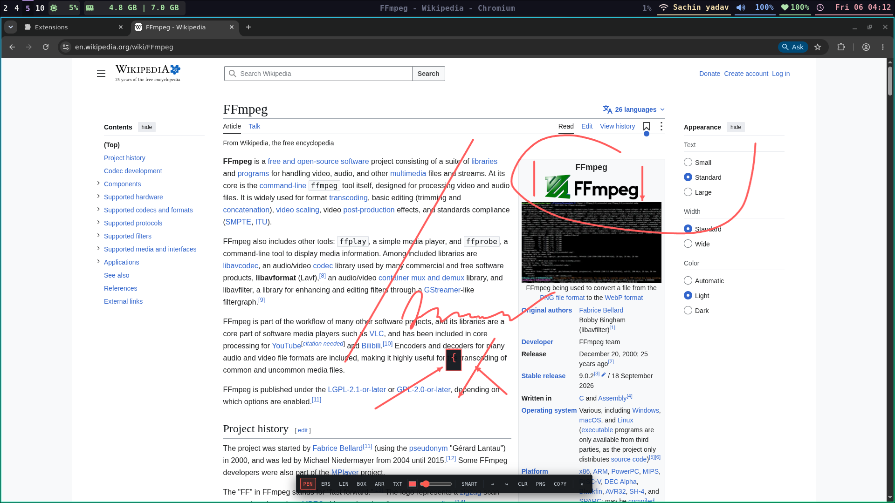
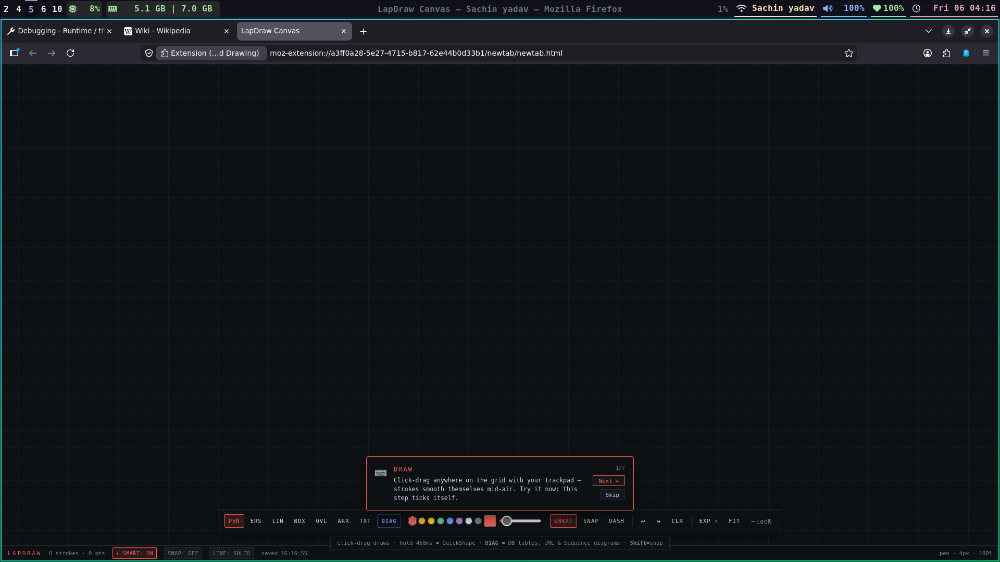
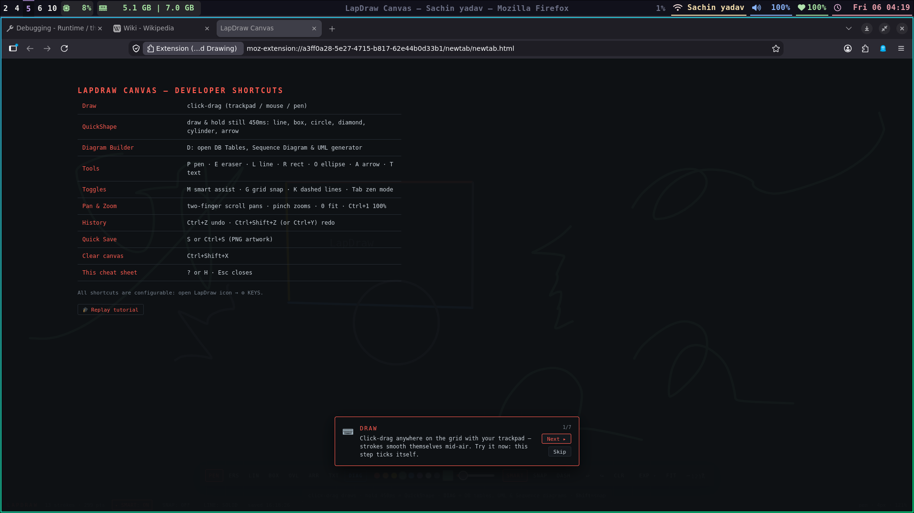
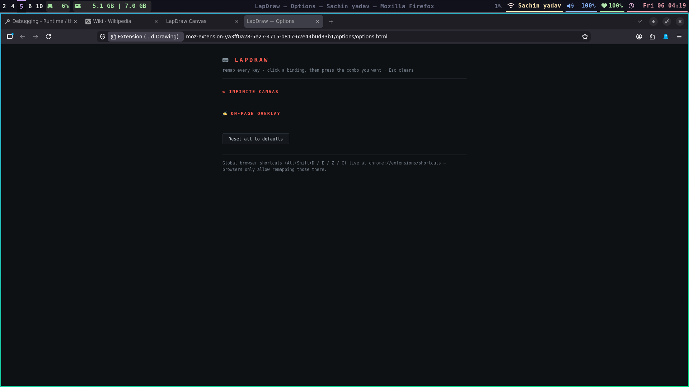

<p align="center">
  
</p>

<h1 align="center">LAPDRAW</h1>

<p align="center">
  <b>Draw on any website with your laptop trackpad — no mouse, no pen, no mess.</b><br/>
  <i>Engineered for software developers, system architects, and code reviewers.</i>
</p>

<p align="center">
  
  
  
  
  
  
  <a href="#-license"></a>
</p>

---

## 📸 Visual Showcase

<p align="center">
  <b>1. On-Page Web & Documentation Annotation (<kbd>Alt+Shift+D</kbd>)</b><br/>
  
</p>

<p align="center">
  <b>2. Infinite Canvas Whiteboard (<kbd>Alt+Shift+C</kbd>)</b><br/>
  
</p>

<p align="center">
  <b>3. Keyboard Maestro Cheatsheet (<kbd>?</kbd>)</b><br/>
  
</p>

<p align="center">
  <b>4. Rebindable Keymap Options</b><br/>
  
</p>

---

## 🖐️ QuickShape: Trackpad Hold-to-Snap

Drawing with a finger on a laptop trackpad causes friction jitter and wobbly shapes. LapDraw fixes this algorithmically:

```
[ 🖐️ Trackpad Doodle ] ───( Hold still for 450ms )───▶ [ ✨ Crisp Vector Shape ]
  Wobbly line, box, circle, arrow, diamond, or cylinder snaps into clean geometry!
```

| ❌ Without LapDraw | ✨ With LapDraw QuickShape |
|---|---|
| Jittery, jagged trackpad strokes | **Catmull-Rom streamline smoothing** mid-air |
| Sharp hook artifact when lifting finger | **Fishhook trimmer** strips end-of-stroke rolls |
| Wobbly, uneven rectangles & circles | **450ms hold-to-snap** calculates radius variance & snaps to clean vectors |

---

## 🔍 GitHub PR Review Mode in 3 Steps

Point out race conditions, memory leaks, and nil pointers visually on any code diff:

```
Step 1: Highlight Code     Step 2: Stamp Review Badge      Step 3: 1-Click Copy
   [ HL Tool / H ]        [ STAMP Menu: LGTM, BUG... ]        [ GH-PR Button / G ]
         │                              │                               │
         ▼                              ▼                               ▼
  Translucent band               Placed directly on             Copies screenshot +
  preserves syntax               line with comment              markdown for comment
```

### Review Stamp Badges
- `✓ [LGTM]` (#2ed573) — Looks good to me
- `✖ [BUG]` (#ff4757) — Crash / unhandled exception
- `🔒 [SECURITY]` (#a55eea) — Injection vulnerability / auth risk
- `✎ [NIT]` (#ffa502) — Code style / formatting
- `⚠ [REQ CHANGES]` (#ff7f50) — Must resolve before merge
- `⚡ [PERF]` (#00d2d3) — O(N²) loop / heavy allocation
- `? [QUESTION]` (#1e90ff) — Clarification needed

---

## 📖 Persistent Documentation & PDF Notebook (<kbd>N</kbd>)

Never lose notes when reading technical specs, RFCs, or local PDFs:

```
[ 🌐 Any Webpage / PDF ] ──▶ [ 📖 URL-Scoped Notes ] ──▶ [ 📥 Export Markdown ]
  (react.dev, mdn, file://)   Auto-saved in local storage     Ready for Obsidian/Notion
```

- **Per-URL Scoped**: Notes restore automatically whenever you revisit the page.
- **Semantic Tag Chips**: 1-click insert `+ [TODO]`, `+ [KEY POINT]`, `+ [API REF]`, `+ [BUG]`.
- **📸 Snapshots**: Embeds drawing screenshot markers directly into notes.
- **💾 1-Click Export**: Downloads clean `.md` Markdown files.

---

## ⚡ Architecture & Sequence Diagram Studio (<kbd>D</kbd>)

Press <kbd>D</kbd> on the infinite canvas to launch the visual diagram generator:

- **Sequence Diagrams**:
  - Lifeline execution activations (vertical CPU processing bars)
  - Combined fragments (`alt / else`, `loop`, `opt`)
  - 3-segment orthogonal self-call loops
- **UML Class Studio**:
  - Stereotypes: `«service»`, `«interface»`, `«entity»`, `«repository»`
  - Colored visibility: `+public`, `-private`, `#protected`, `~package`
  - 6 Relationship connectors: `<|--`, `<|..`, `*--`, `o--`, `..>`, `-->`
- **Database Relational ERD**:
  - Relational schema tables with `PK`, `FK`, and data types (`UUID`, `VARCHAR`, `TIMESTAMPTZ`)
- **Live DSL Compiler**:
  - Type PlantUML/Mermaid-style text on the left, watch it render live into vector strokes on the right!

---

## 🎨 8 Developer Themes (<kbd>THM</kbd>)

| Theme | Swatch | Primary Accent | Vibe |
|---|---|---|---|
| **Omarchy Rice** | ⬛ 🟥 🟦 | Coral `#ff5c50` | Default dark terminal rice |
| **Dracula** | 🟪 🟪 🟩 | Purple `#bd93f9` | Vampire purple & neon pink |
| **Catppuccin** | 🟦 🟪 🟩 | Lavender `#cba6f7` | Soothing pastel dark mocha |
| **Tokyo Night** | 🟦 🟦 🟩 | Cyan `#7dcfff` | Cyberpunk metropolis |
| **Nord Frost** | 🟦 ⬜ 🟩 | Arctic Ice `#88c0d0` | Arctic soft elegance |
| **Monokai Pro** | 🟨 🟥 🟩 | Gold `#ffd866` | Vibrant code syntax |
| **Paper Light** | ⬜ 🟦 🟥 | GitHub Blue `#0969da` | Light paper print mode |
| **Matrix Cyber** | ⬛ 🟩 🟦 | Phosphor `#00ff88` | Green phosphor hacker glow |

---

## 🛠️ Tool Cheat Card

```
┌────────────────────────────────────────────────────────────────────────┐
│  P  PEN      Freehand streamline pen (Hold 450ms for QuickShape)       │
│  H  HL       Translucent highlighter band for code & docs              │
│  E  ERS      Eraser tool                                               │
│  L  LIN      Straight line (Hold Shift for 45° angle snap)             │
│  R  BOX      Box / Rectangle container (Hold Shift for square)         │
│  A  ARR      Directional connector arrow                               │
│  T  TXT      Monospace text note / label                               │
│  F  SPOT     Diff spotlight focus scrim                                │
│  K  STAMP    Review stamp badges menu ([LGTM], [BUG], [SECURITY]...)   │
│  N  NOTES    URL-scoped documentation & PDF notes drawer               │
│  G  GH-PR    Copy composite screenshot + review Markdown to clipboard  │
│  D  DIAG     Sequence diagrams, UML classes & DB schema builder        │
│  ☩  RADAR    Radar minimap overview with camera viewport frustum       │
└────────────────────────────────────────────────────────────────────────┘
```

---

## ⌨️ Global Shortcuts

| Shortcut | Action |
|---|---|
| <kbd>Alt+Shift+D</kbd> | Toggle drawing overlay on any webpage |
| <kbd>Alt+Shift+E</kbd> | Toggle Pen ↔ Eraser |
| <kbd>Alt+Shift+C</kbd> | Open Infinite Canvas tab |
| <kbd>Alt+Shift+Z</kbd> | Undo last stroke |
| <kbd>Two-finger scroll</kbd> | Pan canvas infinitely |
| <kbd>Pinch trackpad</kbd> | Smooth zoom around cursor |
| <kbd>0</kbd> | Fit all content to screen |
| <kbd>Tab</kbd> | Zen mode (hide/show toolbar) |
| <kbd>?</kbd> | Cheat sheet & in-app interactive lab |

*All shortcuts rebindable: click LapDraw icon → **⚙ KEYS**.*

---

## 📦 Install & Build

### Chrome / Brave / Edge (Manifest V3)
```bash
npm run build
```
1. Open `chrome://extensions` and enable **Developer mode**.
2. Click **Load unpacked** and select `dist/chrome`.

### Firefox (Manifest V2)
1. Open `about:debugging#/runtime/this-firefox`.
2. Click **Load Temporary Add-on…** and choose `dist/firefox/manifest.json`.

---

## 📚 Dedicated Documentation & Interactive Lab
- [**Visual Feature Showcase**](src/docs/docs.html) — in-extension visual walkthrough with interactive test pad
- [**Interactive Developer Lab**](src/tutorial/tutorial.html) — 7 hands-on lessons with live simulated GitHub diffs & DSL editor
- [**Developer Architecture Guide**](docs/DEVELOPER_GUIDE.md) — deep-dive reference manual with technical specifications
- [**GitHub Reviews & Docs Notes**](docs/GITHUB_AND_DOCS_NOTES.md) — step-by-step practical review manual

---

## 📄 License
MIT © 2026 Sachin — see [LICENSE](LICENSE). Zero telemetry, zero external dependencies, 100% local.
